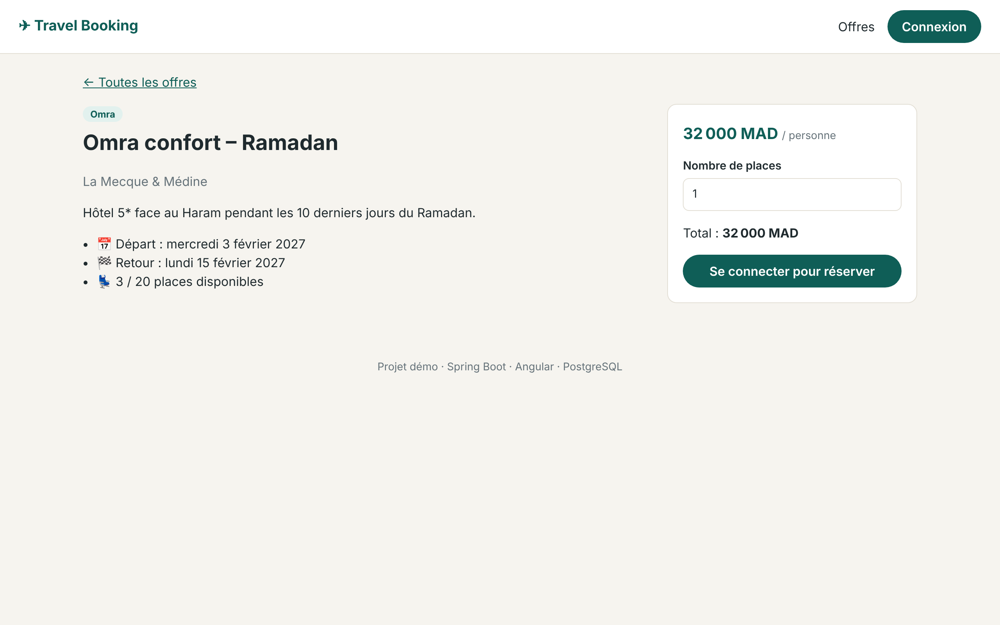
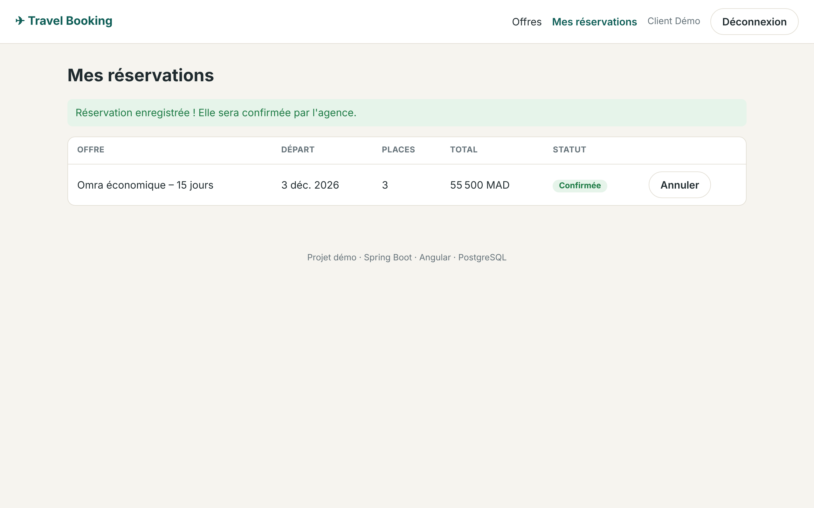
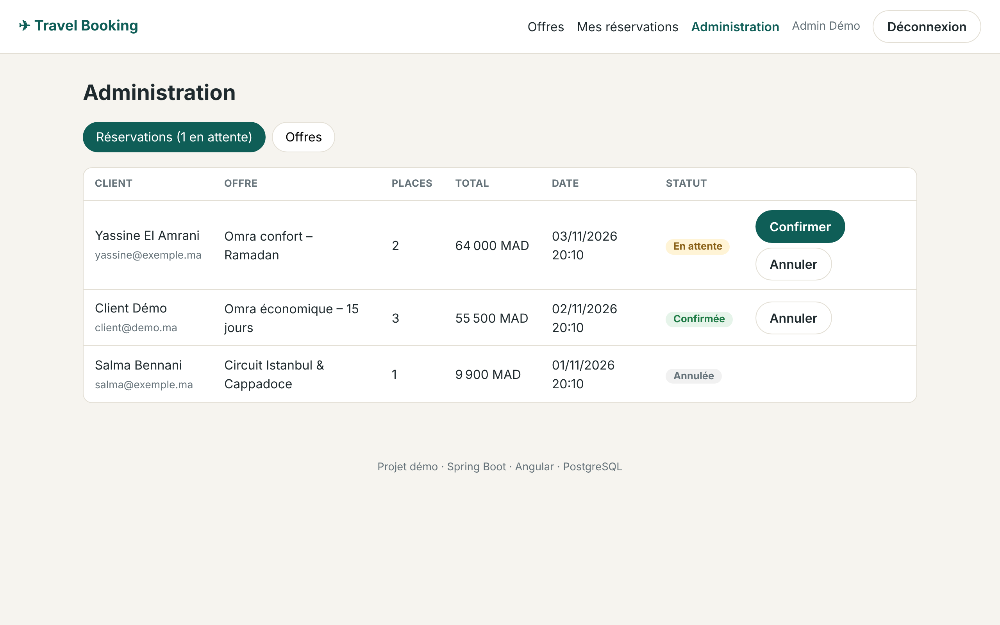

# ✈ Travel Booking Platform

Plateforme de **réservation de voyages** (Omra, Hajj, circuits) : catalogue des offres avec places en temps réel, réservation en ligne, espace client et back-office d'administration.

Projet personnel full stack réalisé avec **Spring Boot 3 / Java 17**, **Angular 18** et **PostgreSQL**.


| Catalogue des offres | Détail et réservation |
|---|---|
|  |  |
| **Espace client** | **Back-office admin** |
|  |  |

## Fonctionnalités

**Client**
- Consulter les offres et les filtrer par type (Omra, Hajj, Voyage)
- Voir les places disponibles en temps réel
- Créer un compte, se connecter (JWT) et réserver une ou plusieurs places
- Suivre et annuler ses réservations

**Administrateur**
- Créer, modifier et supprimer des offres
- Voir toutes les réservations, les confirmer ou les annuler (les places sont libérées automatiquement)

## Points techniques

- **API REST** Spring Boot en couches : controller → service → repository, DTO (records Java)
- **Sécurité** : Spring Security stateless, authentification **JWT**, rôles `CLIENT` / `ADMIN`, mots de passe hachés avec BCrypt
- **Gestion de la concurrence** : verrou pessimiste (`PESSIMISTIC_WRITE`) pour que deux clients ne réservent pas la dernière place en même temps
- **Validation** des données (Bean Validation) et **gestion centralisée des erreurs** (`@RestControllerAdvice`) avec des réponses JSON claires
- **Documentation de l'API** avec Swagger / OpenAPI
- **Tests** : tests unitaires (JUnit 5, Mockito, AssertJ) et tests d'intégration (MockMvc + H2) sur le parcours complet login → réservation → sécurité des rôles
- **Frontend Angular 18** : composants standalone, signals, lazy loading, intercepteur HTTP JWT, guards de routes
- **Docker Compose** (PostgreSQL + backend + frontend Nginx) et **CI GitHub Actions** (build + tests à chaque push)

## Architecture

```
travel-booking-platform/
├── backend/                 API REST Spring Boot
│   └── src/main/java/com/akabli/booking/
│       ├── config/          Sécurité, OpenAPI, données de démo
│       ├── controller/      Endpoints REST (public, client, admin)
│       ├── dto/             Objets d'entrée / sortie (records)
│       ├── entity/          Entités JPA (Offer, Booking, AppUser)
│       ├── exception/       Exceptions métier + handler global
│       ├── repository/      Spring Data JPA
│       ├── security/        JWT (génération, filtre)
│       └── service/         Logique métier
├── frontend/                Application Angular
│   └── src/app/
│       ├── core/            Services, modèles, intercepteur, guards
│       └── pages/           Offres, détail, connexion, réservations, admin
└── docker-compose.yml
```

## Endpoints principaux

| Méthode | URL | Accès | Description |
|---|---|---|---|
| POST | `/api/auth/register` | public | Créer un compte |
| POST | `/api/auth/login` | public | Connexion → token JWT |
| GET | `/api/offers?type=OMRA` | public | Liste des offres |
| GET | `/api/offers/{id}` | public | Détail d'une offre |
| POST | `/api/bookings` | client | Réserver des places |
| GET | `/api/bookings/me` | client | Mes réservations |
| PATCH | `/api/bookings/{id}/cancel` | client | Annuler ma réservation |
| POST / PUT / DELETE | `/api/admin/offers` | admin | Gérer les offres |
| GET | `/api/admin/bookings` | admin | Toutes les réservations |
| PATCH | `/api/admin/bookings/{id}/confirm` | admin | Confirmer une réservation |

Documentation complète : http://localhost:8080/swagger-ui.html

## Lancer le projet

### Avec Docker (le plus simple)

```bash
docker compose up --build
```

- Application : http://localhost:4200
- API / Swagger : http://localhost:8080/swagger-ui.html

### Sans Docker

Prérequis : Java 17, Maven, Node 20, PostgreSQL (base `booking`, utilisateur `booking` / `booking`).

```bash
# Backend
cd backend
mvn spring-boot:run

# Frontend (autre terminal)
cd frontend
npm install
npm start          # http://localhost:4200 (proxy /api -> 8080)
```

### Tests

```bash
cd backend
mvn test
```

## Comptes de démonstration

| Rôle | Email | Mot de passe |
|---|---|---|
| Admin | admin@demo.ma | Admin123! |
| Client | client@demo.ma | Client123! |

## Auteur

**Mustapha Akabli** – Ingénieur d'État en informatique (EMSI), développeur Full Stack Java / Angular
